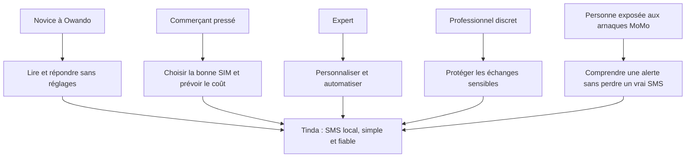
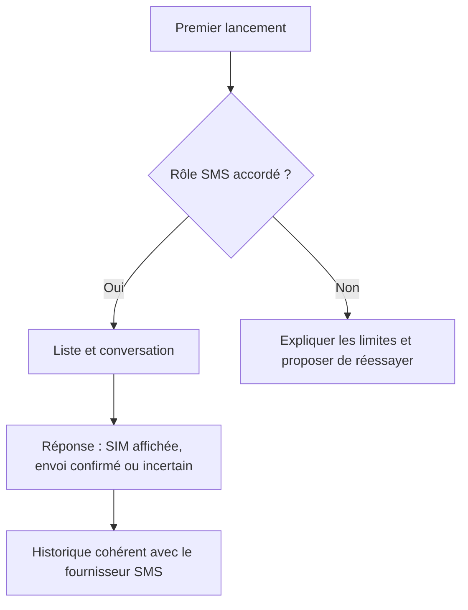
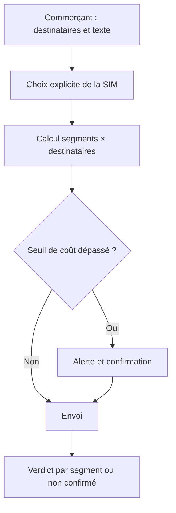
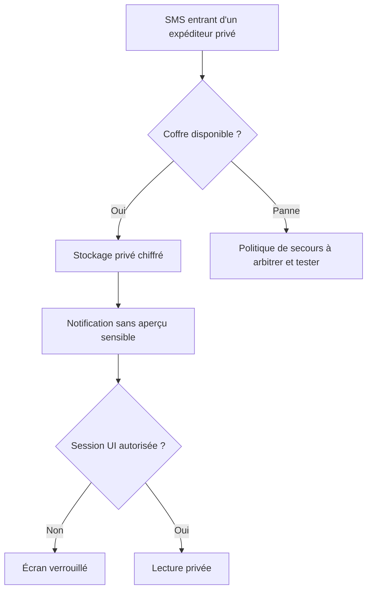
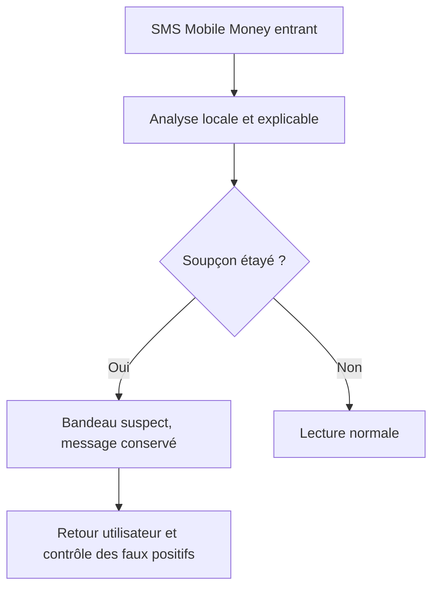
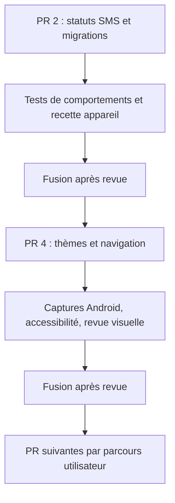

# Tinda SMS : cinq parcours, décisions et travaux à venir

État de référence : 24 octobre 2026. Ce document est une carte de travail, pas une attestation de recette. Les états des PR et des fonctionnalités doivent être revérifiés sur GitHub avant chaque intervention.

Sources : [PRD et décisions](../reference/dossier-muse-2026-10-20.md), [matrice datée du 21 octobre](../validation/matrice-fonctionnalites.md), [plan de reprise](../superpowers/plans/2026-10-20-tinda-reprise-muse.md), [avancement du design](AVANCEMENT-LOT1.md). Les cinq profils ci-dessous correspondent aux regards 2 à 6 du PRD ; ce sont des profils de conception, pas cinq entretiens terrain individuels démontrés.

## Vue des besoins

| Profil et scène | Besoin exprimé | Réponse prévue | Référence | État à confirmer et prochaine preuve |
|---|---|---|---|---|
| Novice : ouvre l'app, lit un SMS, répond | Aucun réglage obligatoire, états compréhensibles | Onboarding du rôle SMS, conversation, réponse, mode simple, « livré » seulement si confirmé | US-001, US-012, DEC-008/010, F1/F2/F8 | Parcours codé en partie et vu sur appareil historiquement. Refaire une recette du build actuel, permissions refusées comprises ; vérifier le mode simple réel. |
| Commerçant : répond vite avec deux SIM ou écrit à un groupe | Éviter la mauvaise SIM et une facture surprise | SIM visible par message, choix avant envoi, attribution par contact, compteur segments × destinataires et confirmation du coût | US-002/008, RB-06, F2/F14 | Les badges SIM et l'attribution existent à des degrés différents ; le compteur groupé et l'alerte restent à livrer. Tester deux SIM réelles et un SMS long. |
| Expert : choisit un thème et programme un rappel | Personnalisation cohérente et automatisations fiables | Sept thèmes, navigation, programmation, récurrence, gestes et modèles | US-003/004, F4/F5/F9/F16 | PR 4 ouverte et non vue sur appareil ; programmation unique partielle, récurrence et alarmes exactes absentes dans la matrice. Vérifier la persistance après redémarrage. |
| Professionnel discret : marque un expéditeur privé | Aucun contenu privé dans les listes, la recherche, les notifications ou le fournisseur normal | Coffre chiffré, session UI distincte de la réception de fond, politique de panne et migration | US-005/006, DEC-004/005, RB-01, F12/F13 | Risque de repli vers le fournisseur signalé ; modèle de clés et comportement en panne non tranchés. Décision SmokeSama avant toute promesse nouvelle, puis tests de panne et de conservation. |
| Personne exposée aux arnaques MoMo : reçoit un SMS suspect | Être avertie sans bloquer un vrai transfert | Bandeau d'avertissement local, jamais de blocage silencieux, liste blanche et mesure des faux positifs | US-007, DEC-006, RB-04, F15 | Prévu, sans moteur validé. Constituer un corpus consenti et anonymisé hors dépôt ; mesurer vrais/faux positifs avant activation. |

## Parcours de bout en bout

Ces schémas sont des **comportements cibles**. Une flèche ne signifie pas que le code actuel l'implémente.

## Dépendances de livraison

| Priorité | Travail | Sortie vérifiable |
|---|---|---|
| P0 | PR 2 : limiter l'exception du code SMS `0` aux preuves appareil réelles et empêcher un état refusé par Room d'être inscrit dans le fournisseur | Tests des transitions et résultats de build au SHA final ; aucune réussite inventée |
| P0 | Coffre : trancher le modèle de clés et la panne, séparer réception technique et autorisation UI | Décision explicite, tests de panne, aucune fuite vers le fournisseur/notification/log, migration non destructive |
| P1 | PR 4 : thèmes, navigation, SIM historique et marges | Captures de vrais écrans, FR/EN, clair/sombre, grandes polices, TalkBack, clavier et deux SIM |
| P1 | Commerçant : coût groupé, attribution SIM et statuts | Calcul visible avant confirmation et essais double SIM/SMS long |
| P1 | Novice : mode simple, refus du rôle SMS, brouillons et recherche complète | Parcours sans impasse ni affirmation trompeuse sur l'historique recherché |
| P2 | Expert : récurrence, exactitude horaire, règles et modèles | Redémarrage, restrictions Android et état incertain démontrés |
| P2 | Protection MoMo | Corpus consenti, protocole de mesure, bandeau sans blocage ; aucun écran « protégé » prématuré |
| P3 | Sauvegarde locale chiffrée, compagnon local, lingala, chatheads et statistiques avancées | Une PR et des preuves distinctes par parcours après arbitrage de la priorité |

Les fonctions futures F17 (SMS simulé), F18 (sauvegarde), F19 (compagnon local), F21 (chatheads) et F22 (lingala) sont des demandes du PRD, **pas des fonctions livrées**. Le SMS simulé exige les garde-fous de DEC-007 ; aucun faux SMS dans le fournisseur système ni dans un export.

## Mode d'emploi pour Muse, Codex et les agents suivants

1. Avant une PR, sélectionner une scène et ses critères US/DEC/RB, puis relire le code et la matrice à la tête actuelle. Corriger le tableau si l'état a évolué ; ne pas transformer un test JVM en preuve sur appareil.
2. Montrer le parcours avant/après, les états de panne et la propriété des données. Quand un arbitre manque (coffre, coût ou protection), proposer des options à SmokeSama et avancer sur les tâches indépendantes.
3. Après une remarque de revue, reproduire, corriger, tester et écrire la leçon : erreur, cause, solution et contrôle préventif. Inclure ce contrôle dans la prochaine PR concernée.
4. Décrire la PR en termes courants : scène, problème, changement visible, bénéfice, preuve et limite. Codex vérifie puis fusionne les PR prêtes ; Muse ne fusionne pas lui-même.
5. Mettre ce graphe à jour lorsque le statut change. Ajouter le lien de PR, le SHA testé et la preuve appareil sans contenu SMS réel, numéro, PIN, secret ni capture privée.
